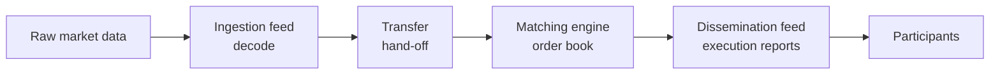

# Quant Engine

A from-scratch, low-latency **stock exchange simulator** written in modern C++ (C++23). It's a showcase of
high-performance systems engineering: every message on the hot path has to be decoded, matched, and reported within a
few hundred nanoseconds, with no heap allocation.

> **Status:** early development. The build, toolchain, and quality gates are in place. The engine components below
> haven't been implemented yet. See [CHANGELOG.md](CHANGELOG.md) for progress.

## Architecture

The system is a single pipeline with four stages:



| Component                     | Responsibility                                                        |
| ----------------------------- | --------------------------------------------------------------------- |
| **Market data ingestion**     | Decodes raw incoming market data messages into internal order events. |
| **Transfer system**           | Moves decoded messages from the ingestion feed to the engine core.    |
| **Matching engine core**      | Maintains the bid/ask order book and matches incoming orders.         |
| **Market data dissemination** | Publishes trade execution reports to market participants.             |

## Performance targets

These targets apply to the **end-to-end hot path** (ingestion → dissemination), measured in steady state **after
warmup**.

| Metric                       | Target                                 | How it is measured                                |
| ---------------------------- | -------------------------------------- | ------------------------------------------------- |
| Latency (p50 / p99 / p99.9)  | < 100 ns / < 250 ns / < 500 ns         | [Google Benchmark] or [nanobench]                 |
| Heap allocations             | 0 `malloc`/`free` and 0 `new`/`delete` | [Valgrind] (`memcheck` heap summary)              |
| Cache-miss rate              | < 1.0 %                                | `perf stat` (`cache-misses` / `cache-references`) |
| Instructions per cycle (IPC) | > 2.5                                  | `perf stat` (`instructions` / `cycles`)           |
| Branch misprediction rate    | < 0.5 %                                | `perf stat` (`branch-misses` / `branches`)        |

> `perf` and Valgrind are Linux tools, so the official numbers are captured on Linux. Development happens on macOS.

## Getting started

### Prerequisites

- CMake **≥ 4.3**
- LLVM/Clang with C++23 support. `CMakeLists.txt` currently pins Homebrew LLVM at `/opt/homebrew/opt/llvm`
  (`brew install llvm`).
- macOS: a working Xcode Command Line Tools install. The CMake configure step fails early with a fix-it hint if
  `xcode-select -p` or the SDK path is broken.

### Build and run

```bash
cmake -S . -B cmake-build-release -DCMAKE_BUILD_TYPE=Release
cmake --build cmake-build-release
./cmake-build-release/the_stock_market_project
```

## Code quality

The repository ships strict, opinionated tooling configuration:

| Tool                                   | Config                | Purpose                                                      |
| -------------------------------------- | --------------------- | ------------------------------------------------------------ |
| [clang-format]                         | `.clang-format`       | Consistent formatting                                        |
| [clang-tidy]                           | `.clang-tidy`         | Lints (bugprone, performance, modernize, Core Guidelines, …) |
| [clangd]                               | `.clangd`             | IDE diagnostics with `-Weverything -Werror`                  |
| [Clang Static Analyzer] (`scan-build`) | `scripts/pre-push.sh` | Path-sensitive bug finding                                   |
| [CodeScene] (`cs delta`)               | n/a                   | Code Health regression check against the base branch         |

`scripts/pre-push.sh` runs every gate and then calls `git push`. It isn't installed as a git hook, so run it directly or
through an alias:

```bash
git config alias.checked-push '!scripts/pre-push.sh'

git checked-push                 # run all gates, push only if they pass
git checked-push --no-push       # run the gates without pushing
git checked-push --push-on-fail  # push even if a gate fails
```

Run `scripts/pre-push.sh --help` for the environment overrides (`CC`, `CXX`, `CLANG_FORMAT`, `CLANG_TIDY`,
`CS_DELTA_BASE`).

## Project layout

```text
.
├── CMakeLists.txt        # Build definition (C++23, macOS SDK sanity checks)
├── main.cpp              # Entry point (placeholder)
├── scripts/pre-push.sh   # Local quality gates + git push
├── .clang-format         # Formatting rules
├── .clang-tidy           # Lint rules
├── .clangd               # Language-server flags
└── CHANGELOG.md          # Project journal
```

[Google Benchmark]: https://github.com/google/benchmark
[nanobench]: https://github.com/martinus/nanobench
[Valgrind]: https://valgrind.org/
[clang-format]: https://clang.llvm.org/docs/ClangFormat.html
[clang-tidy]: https://clang.llvm.org/extra/clang-tidy/
[clangd]: https://clangd.llvm.org/
[Clang Static Analyzer]: https://clang-analyzer.llvm.org/
[CodeScene]: https://codescene.com/
