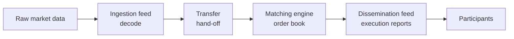

# Quant Engine

A from-scratch, low-latency **stock exchange simulator** written in modern C++ (C++23). It's a showcase of
high-performance systems engineering: every message on the hot path has to be decoded, matched, and reported within a
few hundred nanoseconds, with no heap allocation.

> **Status:** early development. The build, toolchain, and quality gates are in place. The engine components below
> haven't been implemented yet. See [CHANGELOG.md](CHANGELOG.md) for progress.

## Architecture

The system is a single pipeline with four stages:



| Component                     | Responsibility                                                        |
| ----------------------------- | --------------------------------------------------------------------- |
| **Market data ingestion**     | Decodes raw incoming market data messages into internal order events. |
| **Transfer system**           | Moves decoded messages from the ingestion feed to the engine core.    |
| **Matching engine core**      | Maintains the bid/ask order book and matches incoming orders.         |
| **Market data dissemination** | Publishes trade execution reports to market participants.             |

## Performance targets

These targets apply to the **end-to-end hot path** (ingestion → dissemination), measured in steady state **after
warmup**.

| Metric                       | Target                                 | How it is measured                                |
| ---------------------------- | -------------------------------------- | ------------------------------------------------- |
| Latency (p50 / p99 / p99.9)  | < 100 ns / < 250 ns / < 500 ns         | [Google Benchmark] or [nanobench]                 |
| Heap allocations             | 0 `malloc`/`free` and 0 `new`/`delete` | [Valgrind] (`memcheck` heap summary)              |
| Cache-miss rate              | < 1.0 %                                | `perf stat` (`cache-misses` / `cache-references`) |
| Instructions per cycle (IPC) | > 2.5                                  | `perf stat` (`instructions` / `cycles`)           |
| Branch misprediction rate    | < 0.5 %                                | `perf stat` (`branch-misses` / `branches`)        |

> `perf` and Valgrind are Linux tools, so the official numbers are captured on Linux. Development happens on macOS.

## Getting started

### Prerequisites

- CMake **≥ 4.3**
- [Ninja] (`brew install ninja`). Every preset uses it, because the Makefile generators don't support C++ modules.
- A C++23 compiler. The repository doesn't pin one: CMake picks the system default (AppleClang on macOS) unless you
  choose another one in a user preset (see below). The tooling is tested with Homebrew LLVM (`brew install llvm`).
- macOS: a working Xcode Command Line Tools install. The CMake configure step fails early with a fix-it hint if
  `xcode-select -p` or the SDK path is broken.

### Build and run

Builds are driven by [CMake presets][cmake-presets] in `CMakePresets.json`. Each preset builds into `build/<preset>`,
except the two analysis presets. `scripts/pre-push.sh` owns those and recreates them in `.cmake-analysis-build/<preset>`.
They are only enabled when `PRE_PUSH_ANALYSIS=1` is set (pre-push sets it), so IDEs don't list them:

```bash
cmake --preset release
cmake --build --preset release
./build/release/the_stock_market_project
```

| Preset           | Purpose                                                                |
| ---------------- | ---------------------------------------------------------------------- |
| `debug`          | Day-to-day development                                                 |
| `release`        | Optimized build                                                        |
| `relwithdebinfo` | Optimized build with debug info (profiling)                            |
| `clang-tidy`     | Compilation database for clang-tidy (used by `scripts/pre-push.sh`)    |
| `scan-build`     | Clang Static Analyzer build (used by `scripts/pre-push.sh`)            |

`cmake --workflow --preset ci` configures and builds `debug` in one command. List everything with
`cmake --list-presets=all`.

### Choosing your compiler (user presets)

Machine-specific settings go in a git-ignored `CMakeUserPresets.json` that inherits the shared presets, never in a
tracked file. Start from the template:

```bash
cp CMakeUserPresets.json.example CMakeUserPresets.json   # edit paths for your machine
cmake --preset llvm-debug
cmake --build --preset llvm-debug
```

The template shows how to set the compiler, the LLVM install location (`CMAKE_PREFIX_PATH`), a compiler launcher (ccache)
and a custom build directory. CLion and the VS Code CMake Tools extension pick up both files automatically.

A build directory remembers the compiler it was first configured with. After changing compilers, reconfigure from
scratch with `cmake --preset <name> --fresh`.

#### Homebrew LLVM: skip the shell exports

`brew install llvm` suggests exporting `LDFLAGS`, `CPPFLAGS` and `CMAKE_PREFIX_PATH` in your shell. This project needs
none of them, so remove them from your shell profile:

- CMake copies `LDFLAGS` (and `CFLAGS`/`CXXFLAGS`) into a build directory's cache on its **first** configure only, so
  build directories made from different shells silently differ. The configure step warns when this happens.
- CMake ignores `CPPFLAGS`.
- The location of LLVM belongs in your user preset as the `CMAKE_PREFIX_PATH` cache variable, as in the template.
  CMake searches its `bin/` first for `clang-format`, `clang-tidy` and `scan-build`, so the quality gates run from the
  same install as your compiler.

The build links the system `libc++`. So far nothing needs Homebrew's `libc++` or its `_LIBCPP_DISABLE_AVAILABILITY`
flag.

> Don't set `CMAKE_C_COMPILER`/`CMAKE_CXX_COMPILER` on the `scan-build` preset or anything it inherits. scan-build
> selects the compiler through `CC`/`CXX`, and an explicit compiler bypasses it, so the analyzer silently checks
> nothing.

### Editor setup (clangd)

clangd takes the language standard and warnings from your preset's `compile_commands.json`. It only searches each
directory above a source file and that directory's `build/` subdirectory, so it won't find `build/<preset>/` by itself
and falls back to generic flags. Configure and build your preset once, then point clangd at it, either with a git-ignored symlink (works for any
editor)

```bash
ln -s build/llvm-debug/compile_commands.json compile_commands.json
```

or by passing `--compile-commands-dir=build/llvm-debug` in your editor's clangd arguments (for VS Code, `clangd.arguments`
in your user settings). The choice of preset is yours, so it is not in the tracked `.clangd`. CLion doesn't need this:
it gets the flags from its own CMake profile.

## Code quality

The repository ships strict, opinionated tooling configuration:

| Tool                                   | Config                | Purpose                                                      |
| -------------------------------------- | --------------------- | ------------------------------------------------------------ |
| Compiler warnings                      | `CMakeLists.txt`      | `-Weverything` (Clang) as errors, `-std=c++23`               |
| [clang-format]                         | `.clang-format`       | Consistent formatting                                        |
| [clang-tidy]                           | `.clang-tidy`         | Lints (bugprone, performance, modernize, Core Guidelines, …) |
| [clangd]                               | `.clangd`             | IDE diagnostics, using the build's flags                     |
| [Clang Static Analyzer] (`scan-build`) | `scripts/pre-push.sh` | Path-sensitive bug finding                                   |
| [CodeScene] (`cs delta`)               | n/a                   | Code Health regression check against the base branch         |

The warning policy lives in `CMakeLists.txt`, so the build, clang-tidy, scan-build and clangd all see the same flags.
Every warning fails the build. To build anyway while experimenting, configure with
`cmake --preset <name> --compile-no-warning-as-error`. `-Weverything` also enables new diagnostics on every Clang
upgrade, so a compiler bump may need code fixes or an explicit `-Wno-…` in `CMakeLists.txt`.

`scripts/pre-push.sh` runs every gate and then calls `git push`. It isn't installed as a git hook, so run it directly or
through an alias:

```bash
git config alias.checked-push '!scripts/pre-push.sh'

git checked-push                 # run all gates, push only if they pass
git checked-push --no-push       # run the gates without pushing
git checked-push --push-on-fail  # push even if a gate fails
git checked-push --preset llvm-debug  # use the compilers of one of your presets
```

The gates build with the compilers CMake resolves for a configure preset: `debug` (CMake's default compiler) unless you
pass `--preset <name>` or set `PRE_PUSH_PRESET`, usually to one of your user presets. `CC`/`CXX` in the environment
override the preset. clang-format, clang-tidy and scan-build are the ones CMake finds for that preset: first in the
preset's `CMAKE_PREFIX_PATH`, then next to the compiler, then on `PATH`.
Run `scripts/pre-push.sh --help` for all overrides (`CC`, `CXX`, `CLANG_FORMAT`, `CLANG_TIDY`, `SCAN_BUILD`,
`CS_DELTA_BASE`).

## Project layout

```text
.
├── CMakeLists.txt           # Build definition (C++23, warning policy, macOS SDK checks, clang tool lookup)
├── CMakePresets.json        # Shared build presets (Ninja, build/<preset>)
├── CMakeUserPresets.json.example # Template for your git-ignored CMakeUserPresets.json
├── main.cpp                 # Entry point (placeholder)
├── scripts/pre-push.sh      # Local quality gates + git push
├── scripts/get_itch_data.py # Download Nasdaq ITCH captures into data/
├── scripts/decompress.py    # data/**/*.gz -> sibling .bin (Nasdaq ITCH captures)
├── scripts/README.md        # Index of the scripts
├── scripts/itch_story/      # Walk a capture and log its story; README holds what we have learnt about ITCH
├── .clang-format            # Formatting rules
├── .clang-tidy              # Lint rules
├── .clangd                  # Language-server flags
└── CHANGELOG.md             # Project journal
```

[Google Benchmark]: https://github.com/google/benchmark
[Ninja]: https://ninja-build.org/
[cmake-presets]: https://cmake.org/cmake/help/latest/manual/cmake-presets.7.html
[nanobench]: https://github.com/martinus/nanobench
[Valgrind]: https://valgrind.org/
[clang-format]: https://clang.llvm.org/docs/ClangFormat.html
[clang-tidy]: https://clang.llvm.org/extra/clang-tidy/
[clangd]: https://clangd.llvm.org/
[Clang Static Analyzer]: https://clang-analyzer.llvm.org/
[CodeScene]: https://codescene.com/
